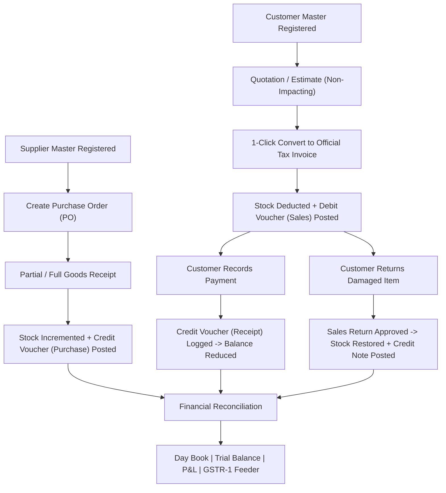

# ⚡ BillFlow Suite — Complete Project Report & System Architecture

> **Comprehensive Billing, Inventory, and Party-wise Double-Entry Accounting Software for Indian B2B Traders, Wholesalers, and Manufacturers**

---

## 📑 Table of Contents
1. [Executive Summary](#1-executive-summary)
2. [How the Software Works (System Architecture & Workflows)](#2-how-the-software-works)
   - [Architectural Paradigm](#21-architectural-paradigm)
   - [The Complete Commercial & Accounting Lifecycle](#22-the-complete-commercial--accounting-lifecycle)
   - [Automated Inventory & Stock Sync Engine](#23-automated-inventory--stock-sync-engine)
   - [GST Calculation & Tax Classification Mechanics](#24-gst-calculation--tax-classification-mechanics)
   - [Party-wise Running Ledger (Bahi-Khata Engine)](#25-party-wise-running-ledger-bahi-khata-engine)
3. [Comprehensive Feature Breakdown by Module](#3-comprehensive-feature-breakdown-by-module)
   - [Master Data Management](#31-master-data-management)
   - [Billing & Outward Sales Operations](#32-billing--outward-sales-operations)
   - [Procurement & Inward Supply Chain](#33-procurement--inward-supply-chain)
   - [Financial Vouchers & Accounting](#34-financial-vouchers--accounting)
   - [Inventory & Stock Audit](#35-inventory--stock-audit)
   - [Business Intelligence & Financial Reports](#36-business-intelligence--financial-reports)
   - [Export & Document Generation Engine](#37-export--document-generation-engine)
   - [Security, Offline Licensing & Disaster Recovery](#38-security-offline-licensing--disaster-recovery)
4. [Recent QA Audit & Resolved Defects](#4-recent-qa-audit--resolved-defects)
5. [Database Schema & Data Model](#5-database-schema--data-model)
6. [Technology Stack](#6-technology-stack)
7. [Installation, Setup & Quick Start](#7-installation-setup--quick-start)
8. [Keyboard Shortcuts Cheatsheet](#8-keyboard-shortcuts-cheatsheet)
9. [Automated Testing & Quality Assurance](#9-automated-testing--quality-assurance)

---

## 1. Executive Summary

**BillFlow Suite** is an offline-first, high-throughput desktop application engineered specifically for the operational demands of Indian B2B trading enterprises, industrial distributors, and wholesale merchants.

Traditional business software in India often forces a compromise between lightweight billing apps (which lack double-entry ledger discipline) and complex ERP packages (which impose high subscription fees and steep learning curves). **BillFlow Suite bridges this divide** by delivering:
* **True Double-Entry Ledger Posting**: Every finalized invoice, delivery receipt, payment, or credit note automatically syncs to a running statement of account.
* **GST-Compliant Commercial Billing**: Automated splitting of Intra-state (CGST + SGST) vs Inter-state (IGST) taxes across all standard GST slabs (0%, 5%, 12%, 18%, 28%).
* **Real-time Inventory Tracking**: Accurate warehouse management supporting partial purchase order receipts, sales return restorations, and low-stock triggers.
* **Executive Document Engine**: Vector PDF creation via **ReportLab** and formatted spreadsheet creation via **openpyxl** for Chartered Accountants.
* **Zero-Cloud Dependency & Hardware Locking**: Fully functional offline operation with local SQLite storage and tamper-proof HMAC-SHA256 hardware licensing with anti-tamper clock verification.

---

## 2. How the Software Works

### 2.1 Architectural Paradigm

BillFlow Suite follows a decoupled **Model-View-Service** architecture optimized for Python 3.12 - 3.14 (tested on 3.12 and 3.14) and Qt6 (PySide6):

```
┌────────────────────────────────────────────────────────────────────────┐
│                   PySide6 (Qt6) Executive GUI Layer                   │
│   Dashboard  │  Party Master  │  Invoices  │  Ledger  │  Reports       │
└───────────────────────────────────┬────────────────────────────────────┘
                                    │ (UI Actions / Signals)
                                    ▼
┌────────────────────────────────────────────────────────────────────────┐
│                   Business Logic & Service Layer                       │
│  ├── gst_engine.py          ├── invoice_service.py  ├── pnl_service.py │
│  ├── party_service.py       ├── quotation_service.py├── report_service │
│  ├── voucher_service.py     ├── purchase_order_svc  ├── export_service │
│  └── ledger_service.py      └── return_service.py   └── license_service│
└───────────────────────────────────┬────────────────────────────────────┘
                                    │ (SQLAlchemy ORM 2.0)
                                    ▼
┌────────────────────────────────────────────────────────────────────────┐
│                   Data Storage & Persistence Layer                     │
│    SQLite Database (WAL Mode)  │  data/accounting.db  │  Auto-Backups   │
└────────────────────────────────────────────────────────────────────────┘
```

1. **Presentation Layer (`app/ui/`)**: Built using PySide6 with an executive Bahi-Khata theme. Views utilize asynchronous background workers (`QThreadPool` / `QRunnable`) for exports, reports, and backups to prevent UI freezing.
2. **Business Services Layer (`app/services/`)**: Enforces validation, transactional consistency, tax mathematics, inventory state transitions, and audit generation.
3. **Data Access Layer (`app/database/`)**: SQLAlchemy ORM with SQLite configured in Write-Ahead Logging (`WAL`) mode to prevent concurrency locks during heavy read/write operations.

---

### 2.2 The Complete Commercial & Accounting Lifecycle

BillFlow unifies procurement, sales, inventory, and accounting into one continuous data flow:



1. **Procurement**: A Purchase Order is drafted and sent to a Supplier. Upon receipt of goods, items are inspected. Receiving stock immediately updates warehouse inventory and posts a Credit Voucher to the Supplier’s ledger.
2. **Sales**: A sales quotation is prepared. Upon customer acceptance, 1-click conversion generates an official Tax Invoice, assigns a sequence number (`INV/YYYY-YY/XXXX`), depletes inventory stock, and posts a Debit Voucher to the Customer’s ledger.
3. **Settlement**: When payments arrive (Cash, Bank Transfer, NEFT/RTGS, UPI), a Receipt Voucher is booked against the party, reducing their outstanding balance.
4. **Returns**: If goods are returned, an authorized Sales Return generates an accounting Credit Note, reducing the party’s dues and restoring stock levels.
5. **Reconciliation**: All financial vouchers feed directly into the **Day Book**, **Trial Balance**, **Profit & Loss Statement**, and **GSTR-1 Feeder Reports**.

---

### 2.3 Automated Inventory & Stock Sync Engine

Inventory in BillFlow is governed by strict physical tracking rules:
* **Stock Deductions**: Finalized Tax Invoices decrement stock quantities. Draft quotes and delivery challans do not alter ledger stock until converted or marked dispatched.
* **Cumulative Goods Receipt**: Purchase Orders support iterative partial deliveries. The database tracks `received_quantity` cumulatively on each line item. Receiving 20 units out of a 50-unit order marks the PO as `"partially_received"` and increases stock by 20. Receiving the remaining 30 updates the PO to `"received"` and increases stock by 30.
* **Return Adjustments**: Approving a Sales Return automatically restores stock; approving a Purchase Return removes defective stock from the warehouse.
* **Cancellations**: Cancelling an invoice restores all item quantities to warehouse stock and marks ledger vouchers inactive.

---

### 2.4 GST Calculation & Tax Classification Mechanics

The billing engine incorporates Indian Goods and Services Tax statutory logic:
* **Place of Supply (POS) Classification**:
  * **Intra-State**: When the Party’s State Code matches the Company’s State Code, GST is split equally into **CGST** and **SGST** (e.g., 18% = 9% CGST + 9% SGST).
  * **Inter-State**: When State Codes differ, tax is calculated as single **IGST** (e.g., 18% IGST).
* **Multi-Slab Support**: Calculates taxes on a per-item basis supporting 0%, 5%, 12%, 18%, and 28% slabs within the same invoice.
* **Commercial Promotions & Discounts**:
  * Cash discounts are deducted from taxable value before GST application.
  * 100% discount promotion items (commercial samples) are calculated at ₹0 taxable value and ₹0 tax without triggering zero-division exceptions.
* **High-Precision Decimals**: All financial calculations use Python's `Decimal` type to prevent binary floating-point roundoff errors.

---

### 2.5 Party-wise Running Ledger (Bahi-Khata Engine)

Every party maintains a continuous, running statement of account:
* **Opening Balance**: Initial opening balance (`Dr` or `Cr`) as of a specified opening date.
* **Running Balance Calculation**:
  $$\text{Net Balance} = \text{Opening Balance} + \sum \text{Debits} - \sum \text{Credits}$$
* **Terminology**:
  * **Debit ($\text{Dr}$)**: Money receivable (Customer owes money).
  * **Credit ($\text{Cr}$)**: Money payable (We owe Supplier money).
* **Automated Audit Reminders**: Single-click generation of formatted WhatsApp payment reminders containing the party's current balance, overdue invoices, and bank transfer details.

---

## 3. Comprehensive Feature Breakdown by Module

### 3.1 Master Data Management
* **Party Master**:
  * Separation and unified tracking of Customers, Suppliers, or dual-role parties (`Both`).
  * Strict validation for 15-character Indian GSTINs, 10-digit mobile numbers, and email formats.
  * Party code generation with collision-free numbering (`CUST-0001`, `SUPP-0001`).
  * Credit limit and credit period days tracking with automated overdue notifications.
* **Product Catalog**:
  * Item descriptions, units of measurement (`PCS`, `KGS`, `MTR`, `BOX`, `TON`), HSN codes, barcode/SKU indexing.
  * Selling price, purchase price, GST tax slab assignment, and low-stock alert thresholds.
  * Prevention of duplicate product names and duplicate SKUs.
* **Company Profile**:
  * Comprehensive business identity management: Trade Name, Legal Name, GSTIN, PAN, Address, State Code, Contact Details, Bank Account, IFSC, UPI ID, and custom logo upload for PDF invoice headers.

---

### 3.2 Billing & Outward Sales Operations
* **Tax Invoices**:
  * Compliant GST tax invoice generation with financial-year sequential numbering (`INV/2026-27/0001`).
  * Multi-item line entry with auto-calculating taxable values, discounts, and GST breakdowns.
  * Transporter details, vehicle numbers, e-Way bill numbers, LR numbers, and dispatch destinations.
  * Instant generation of executive A4 tax invoice PDFs complete with amount in Indian words, bank payment details, and terms & conditions.
* **Quotations & Estimates**:
  * Create, edit, and track sales estimates without impacting accounting ledgers or inventory stock.
  * Status management: `draft`, `sent`, `accepted`, `converted`, `rejected`.
  * Single-click conversion into an official Tax Invoice with automatic stock reduction and ledger voucher posting.
* **Proforma Invoices**:
  * Generate commercial proforma invoices for advance payment requests with linked invoice tracking.
* **Delivery Challans**:
  * Goods delivery notes for dispatch, job-work, or approval basis.
  * 1-click conversion to Tax Invoice upon delivery confirmation.
* **Sales Returns (Credit Notes)**:
  * Reference original invoice numbers with validation preventing return quantities from exceeding original invoiced quantities.
  * Automatic stock restoration and credit note voucher posting to the customer ledger.

---

### 3.3 Procurement & Inward Supply Chain
* **Purchase Orders (PO)**:
  * Draft orders to suppliers with expected delivery dates, payment terms, and negotiated unit rates.
* **Goods Receipt & Delivery Tracking**:
  * Incremental partial goods receipt tracking.
  * Automatic purchase voucher posting (`Credit` to supplier ledger) upon goods arrival.
* **Purchase Returns (Debit Notes)**:
  * Issue debit notes for damaged or rejected goods, reducing payables and adjusting warehouse stock.

---

### 3.4 Financial Vouchers & Accounting
* **Debit Vouchers**: Sales, customer debits, and debit notes.
* **Credit Vouchers**: Purchases, supplier credits, and payment receipts.
* **Journal Vouchers**: Adjustment entries, discount write-offs, bad-debt write-downs, and contra transfers.
* **Cash & Bank Book**:
  * Bank and cash accounts management with transaction registers.
  * Cash deposits, cash withdrawals, and inter-bank contra transfers with mirror balancing entries.

---

### 3.5 Inventory & Stock Audit
* **Live Stock Status**: Instant visibility into on-hand quantities and valuation (Stock valuation: current stock × latest purchase price; see [KNOWN_LIMITATIONS.md](docs/KNOWN_LIMITATIONS.md)).
* **Low Stock Alerts**: Real-time identification of items falling below minimum safety thresholds.
* **Stock Movement Reconciliation**: Detailed audit log aggregating purchases, inward returns, outward sales, and credit returns to reconcile total inventory movement.

---

### 3.6 Business Intelligence & Financial Reports
* **Dashboard KPIs**: Live financial cards showing Total Receivables, Total Payables, Today's Collections, Monthly Sales, and 6-month Debits vs. Credits trend charts.
* **Party Ledger Statement**: Complete chronological transaction journal with running balances, filterable by custom date ranges.
* **Outstanding Dues & Ageing Report**: Categorizes outstanding balances into aging buckets (**0–30 days**, **31–60 days**, **61–90 days**, and **90+ days**).
* **Transaction Day Book**: Chronological daily audit log of all financial vouchers.
* **Trial Balance**: Complete list of all debit and credit balances verifying double-entry arithmetic equality.
* **Profit & Loss Statement (P&L)**:
  * Computes total revenue, Cost of Goods Sold (COGS), gross profit, operating expenses by category, and net profit.
  * Features the polymorphic `ProfitAmount` engine allowing both arithmetic computation (`pnl["gross_profit"] + 100`) and dictionary-style access (`pnl["gross_profit"]["amount"]`).
* **GST Feeder Reports**:
  * Outward B2B sales supply breakdown for **GSTR-1**.
  * Inward purchase tax summary for **GSTR-3B** Input Tax Credit (ITC) reconciliation.

---

### 3.7 Export & Document Generation Engine
* **ReportLab Vector PDF Generation**:
  * A4 Tax Invoices, Quotations, and Party Ledger statements.
  * Includes company logo, header details, multi-column tables, amounts in Indian words (Lakhs/Crores), and authorized signatory blocks.
* **CA-Ready Excel Spreadsheets (openpyxl)**:
  * Professional styling with executive dark headers, auto-fitted columns, borders, and bold total rows.
  * Direct exports for Party Ledgers, Outstanding Ageing, Day Books, and Trial Balances.
* **Polymorphic Export Adapters**:
  * Functions accept an entity ID, a pre-computed dictionary, or `None` (auto-loading live data).

---

### 3.8 Security, Offline Licensing & Disaster Recovery
* **Hardware-Locked Offline Licensing**:
  * Generates a unique 16-character Machine Fingerprint using motherboard and CPU BIOS serials.
  * Offline HMAC-SHA256 license signature verification without requiring internet connectivity.
  * Built-in 14-day free evaluation period.
* **Disaster Recovery & Backup Engine**:
  * 1-click snapshot creation of the active SQLite database.
  * Full database restore with transactional safety and WAL checkpointing.

---

## 4. Recent QA Audit & Resolved Defects

During the QA audit, 7 defects were identified and fixed:

| Bug # | Defect Description | Root Cause | File Changed | Resolution Details | Status |
| :---: | :--- | :--- | :--- | :--- | :---: |
| **Bug 1** | `SyntaxError` in product service | Reserved keyword `or` imported from SQLAlchemy | [product_service.py](file:///c:/Users/surjy/OneDrive/Desktop/Accounting%20Software/app/services/billing/product_service.py) | Replaced with `or_` import and updated all filter clauses | **RESOLVED** |
| **Bug 2** | Quotation conversion missing ledger voucher | Conversion generated invoice but no accounting voucher | [quotation_service.py](file:///c:/Users/surjy/OneDrive/Desktop/Accounting%20Software/app/services/billing/quotation_service.py)<br/>[invoice_service.py](file:///c:/Users/surjy/OneDrive/Desktop/Accounting%20Software/app/services/billing/invoice_service.py) | Extracted shared `post_sales_voucher` helper called atomically by quotes, invoices, and challans | **RESOLVED** |
| **Bug 3** | PO partial receipts not tracked & `NameError` | `PurchaseOrderItem` lacked received quantity column; undefined `is_partial` | [models.py](file:///c:/Users/surjy/OneDrive/Desktop/Accounting%20Software/app/database/models.py)<br/>[connection.py](file:///c:/Users/surjy/OneDrive/Desktop/Accounting%20Software/app/database/connection.py)<br/>[purchase_order_service.py](file:///c:/Users/surjy/OneDrive/Desktop/Accounting%20Software/app/services/billing/purchase_order_service.py) | Added `received_quantity`, automatic PRAGMA migration, backfill, over-receipt validation, and fixed narration variable | **RESOLVED** |
| **Bug 4** | `get_day_book()` required `to_date` | Missing default argument in signature | [report_service.py](file:///c:/Users/surjy/OneDrive/Desktop/Accounting%20Software/app/services/report_service.py) | Made `to_date` optional, defaulting to `from_date` (and `from_date` defaulting to `date.today()`) | **RESOLVED** |
| **Bug 5** | Expense summary missing keys | Returned only `grand_total` | [expense_service.py](file:///c:/Users/surjy/OneDrive/Desktop/Accounting%20Software/app/services/expense_service.py) | Added `total_amount` (float) and `expense_count` (sum of category counts) | **RESOLVED** |
| **Bug 6** | P&L field compatibility | Missing `cogs` alias and incompatible gross profit types | [pnl_service.py](file:///c:/Users/surjy/OneDrive/Desktop/Accounting%20Software/app/services/pnl_service.py) | Returned both `cogs` and `cost_of_goods`; wrapped gross/net profit in `ProfitAmount(float)` | **RESOLVED** |
| **Bug 7** | Export functions rejected IDs and `None` | Functions only supported pre-computed dictionaries | [export_service.py](file:///c:/Users/surjy/OneDrive/Desktop/Accounting%20Software/app/services/export_service.py) | Made all export functions polymorphic to accept IDs, dicts, or `None` with automatic data loading | **RESOLVED** |

---

## 5. Database Schema & Data Model

The application utilizes 20 relational entities managed through SQLAlchemy:

```
  ┌──────────────┐          ┌───────────────────┐
  │   parties    │◄─────────┤     vouchers      │
  └──────┬───────┘          └─────────┬─────────┘
         │                            │
         │ 1:N                        │ 1:N
         ▼                            ▼
  ┌──────────────┐          ┌───────────────────┐
  │   invoices   │          │   voucher_items   │
  └──────┬───────┘          └───────────────────┘
         │ 1:N
         ▼
  ┌──────────────┐          ┌───────────────────┐
  │invoice_items │─────────►│     products      │
  └──────────────┘          └─────────▲─────────┘
                                      │ 1:N
                            ┌─────────┴─────────┐
                            │purchase_order_item│
                            └─────────▲─────────┘
                                      │ N:1
                            ┌─────────┴─────────┐
                            │  purchase_orders  │
                            └───────────────────┘
```

* **Master Tables**: `parties`, `products`, `company_profile`, `expense_categories`, `bank_accounts`, `license_record`.
* **Billing Tables**: `invoices`, `invoice_items`, `quotations`, `quotation_items`, `delivery_challans`, `challan_items`, `proforma_invoices`, `proforma_items`.
* **Procurement Tables**: `purchase_orders`, `purchase_order_items`, `purchase_returns`, `purchase_return_items`.
* **Accounting Tables**: `vouchers`, `voucher_items`, `sales_returns`, `sales_return_items`, `expenses`, `cash_bank_transactions`, `activity_logs`.

---

## 6. Technology Stack

| Layer | Component | Version | Role in Architecture |
| :--- | :--- | :--- | :--- |
| **Language** | Python | 3.12 - 3.14 | Core runtime with native `Decimal` financial precision (tested on 3.12 and 3.14) |
| **UI Framework** | PySide6 | 6.5+ | Modern Qt6 GUI with executive dark/light themes |
| **ORM / Database**| SQLAlchemy & SQLite | 2.0+ / 3.x | Local SQL engine configured in Write-Ahead Logging (`WAL`) mode |
| **PDF Engine** | ReportLab | 4.0+ | Vector A4 printing of tax invoices, quotations, and statements |
| **Excel Engine** | openpyxl | 3.1+ | Multi-tab CA-ready spreadsheet generation with custom formatting |
| **Cryptography** | `hashlib` & `hmac` | Standard Lib | Hardware-bound SHA-256 license signature verification |
| **Testing** | pytest & unittest | 8.x / 9.x | 46 unit tests and 38 comprehensive QA integration scenarios |

---

## 7. Installation, Setup & Quick Start

### 7.1 Prerequisites
* Python 3.12 - 3.14 (tested on 3.12 and 3.14).
* Git (optional).
* Windows 10/11, macOS, or Linux.

### 7.2 Installation
1. Clone or download the repository to your local directory:
   ```bash
   cd "Accounting Software"
   ```
2. Create and activate a virtual environment (recommended):
   ```bash
   python -m venv venv
   # Windows:
   .\venv\Scripts\activate
   # Linux/macOS:
   source venv/bin/activate
   ```
3. Install required dependencies:
   ```bash
   pip install -r requirements.txt
   ```

### 7.3 Launching the Application
Launch via Python module:
```bash
python -m app.main
```
Or double-click `run_app.bat` on Windows.

---

## 8. Keyboard Shortcuts Cheatsheet

Designed for high-speed counter billing and keyboard-only operation:

| Shortcut Key | Action / View Navigation |
| :---: | :--- |
| <kbd>F1</kbd> | ➕ Create New Debit Voucher |
| <kbd>F2</kbd> | ➕ Create New Credit Voucher |
| <kbd>F3</kbd> | ➕ Create New Journal Voucher |
| <kbd>F5</kbd> | 📖 Open Party Ledger View |
| <kbd>F6</kbd> | ⏳ Open Outstanding & Ageing Report |
| <kbd>F7</kbd> | 📅 Open Day Book |
| <kbd>F8</kbd> | ⚖️ Open Trial Balance Sheet |
| <kbd>F9</kbd> | 🧾 Create New Tax Invoice |
| <kbd>F10</kbd> | 📦 Open Products & Inventory Management |
| <kbd>F11</kbd> | 🛒 Open Purchase Orders View |
| <kbd>F12</kbd> | 📊 Open Billing Reports & Sales KPIs |

---

## 9. Automated Testing & Quality Assurance

The codebase includes full automated test coverage across all layers:

### Running the Pytest Suite
```bash
pytest tests/
```
**Expected Output**:
```
============================= 46 passed in 2.88s ==============================
```

### Running the QA Audit Suite
Executes the full 38-step commercial supply chain audit:
```bash
python tests/test_full_qa_suite.py
```
**Coverage Verification**:
* Master party creation and boundary validations (rejecting duplicate names, invalid GSTIN, invalid phones).
* Product creation across all GST slabs (0%, 5%, 12%, 18%, 28%) and negative price blocks.
* Purchase order partial-to-full goods receipt cycles.
* Tax invoice generation, decimal quantity precision (e.g. 3.750 KG), and automatic ledger debit vouchers.
* Quotation creation and non-account-impacting checks.
* Sales returns quantity boundary blocks and credit note ledger posting.
* Full arithmetic equality of the Trial Balance and reconciliation of Profit & Loss statements.
